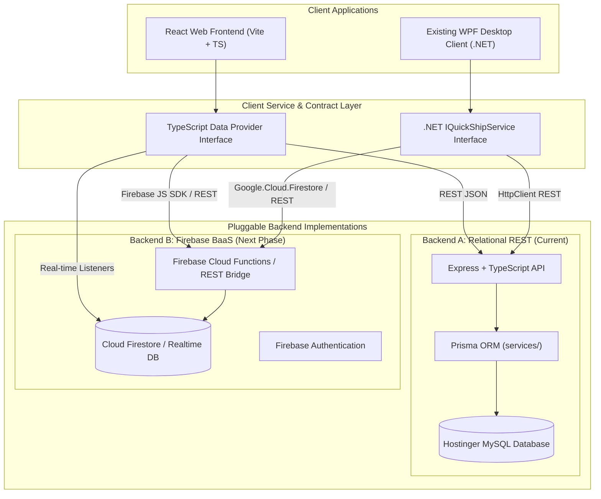

# QuickShip — System Architecture & Evolution Design Document

## 1. Executive Summary & Vision

**QuickShip** is a multi-client, multi-backend logistics and parcel tracking platform designed to manage end-to-end delivery operations: customer onboarding, pickup/delivery address management, shipment creation, multi-package dimension tracking, courier dispatch, and real-time shipment status history.

This project serves both as an operational logistics platform and as an **architectural testbed** to evaluate and benchmark different frontend and backend paradigms side-by-side:
- **Frontends**:
  1. **React + TypeScript Web App** (`frontend/`) for browser-based operations and customer tracking.
  2. **WPF (.NET Desktop) Client** (existing desktop application) for high-density dispatcher/warehouse workflows.
- **Backends**:
  1. **Phase 1 (Current)**: REST API powered by **Node.js, Express, Prisma ORM, and Hostinger MySQL**.
  2. **Phase 2 (Planned)**: Serverless / BaaS backend powered by **Google Firebase** (Cloud Firestore, Firebase Auth, Cloud Functions) to compare real-time synchronization, offline support, latency, developer velocity, and operational cost.

---

## 2. Multi-Client, Multi-Backend Target Architecture

To allow both the **React Web App** and the **WPF Desktop Client** to switch seamlessly between the **Node.js + MySQL** backend and the **Firebase** backend without rewriting UI or business logic, QuickShip uses a **Contract-First / Repository & Adapter Pattern**.

---

## 3. Domain Model & Data Schema

### 3.1 Relational (MySQL) vs. Document (Firebase Firestore) Mapping

When porting the schema to **Firebase Cloud Firestore**, normalizing all 7 tables into separate top-level collections would require expensive client-side joins. Instead, Firestore favors **aggregate-oriented document modeling**:

| Domain Entity | MySQL (Prisma) Strategy | Firebase Firestore Strategy | Rationale |
| :--- | :--- | :--- | :--- |
| **Customer** | `Customer` table | `customers/{customerId}` collection | Queried independently by dispatchers and auth profile. |
| **Courier** | `Courier` table | `couriers/{courierId}` collection | Independent lifecycle; tracks active driver status. |
| **Address** | `Address` table | `addresses/{addressId}` collection + denormalized snapshot inside `shipments/{id}` | Reusable address book per customer, plus immutable snapshot on shipment. |
| **Shipment** | `Shipment` table | `shipments/{shipmentId}` root collection (indexed by `trackingNumber`) | Primary aggregate root for tracking and dispatch. |
| **Package** | `Package` table (`FK shipmentId`) | Embedded array `packages: [...]` inside `shipments/{shipmentId}` | A shipment typically has 1–20 boxes; always loaded with the shipment. |
| **Status History** | `ShipmentStatusHistory` table | Embedded array `statusHistory: [...]` or subcollection `shipments/{id}/statusHistory` | Subcollection or array enables real-time `onSnapshot` listeners in React & WPF. |
| **Delivery Assignment** | `DeliveryAssignment` table | Subcollection `shipments/{id}/assignments` + `activeCourierId` on Shipment | Preserves assignment audit trail while keeping courier queries fast. |

---

## 4. Phased Roadmap

1. **Phase 1 (Complete)**: Folder structure, Hostinger MySQL schema (7 tables), Express + Prisma API, React + TS dashboard.
2. **Phase 2 (Service Layer & Validation)**: Extract `backend/src/services/` repository interfaces; add Zod request validation middleware in `backend/src/middleware/`.
3. **Phase 3 (WPF Client Integration)**: Connect the existing WPF desktop frontend to the standardized REST API and verify cross-client workflows with React.
4. **Phase 4 (Firebase Backend Implementation)**: Set up Firebase project (Firestore + Auth + Functions); implement Firebase data provider with a runtime backend switcher in the UI.
5. **Phase 5 (Benchmarking & Comparison)**: Compare MySQL vs. Firebase across latency, real-time tracking updates, offline resilience, and query flexibility.

